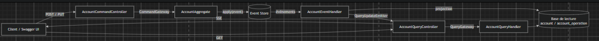
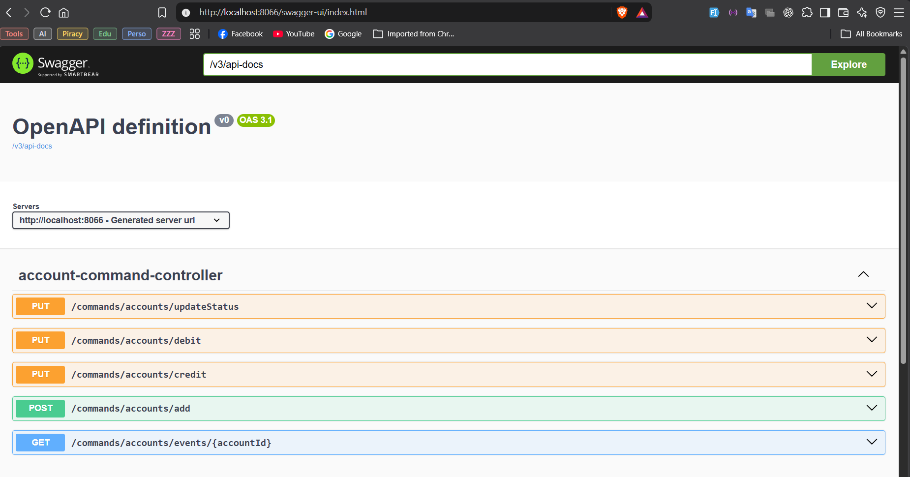
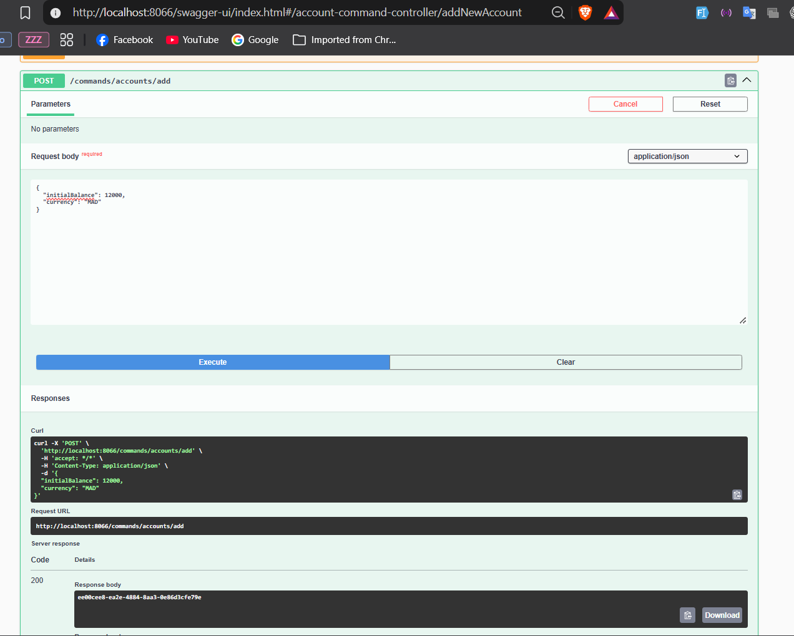
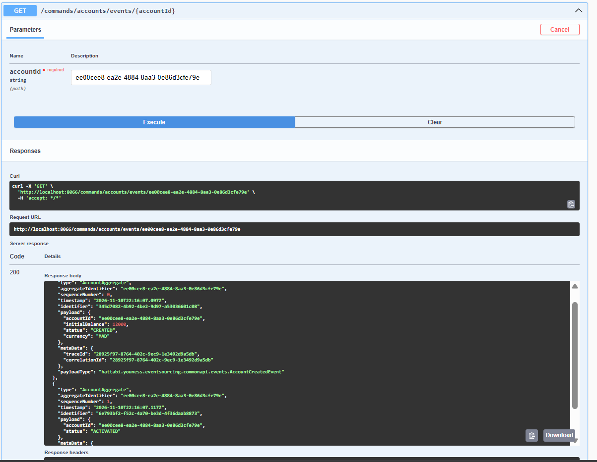
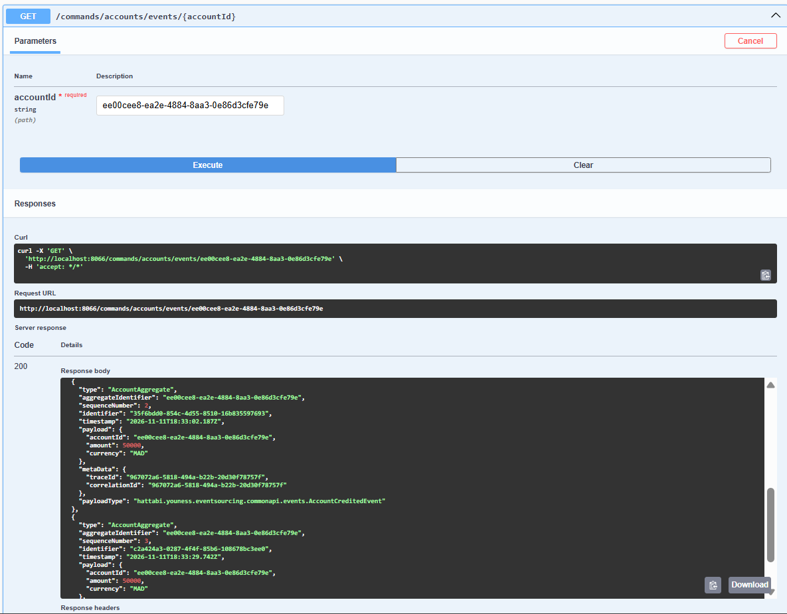
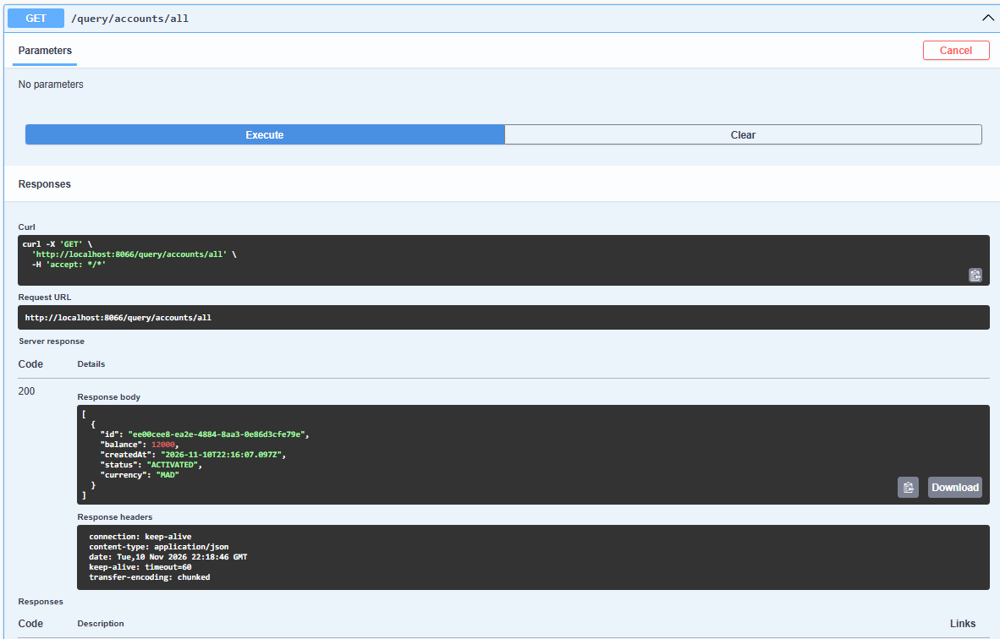
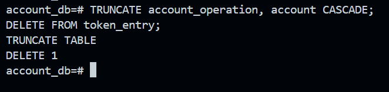
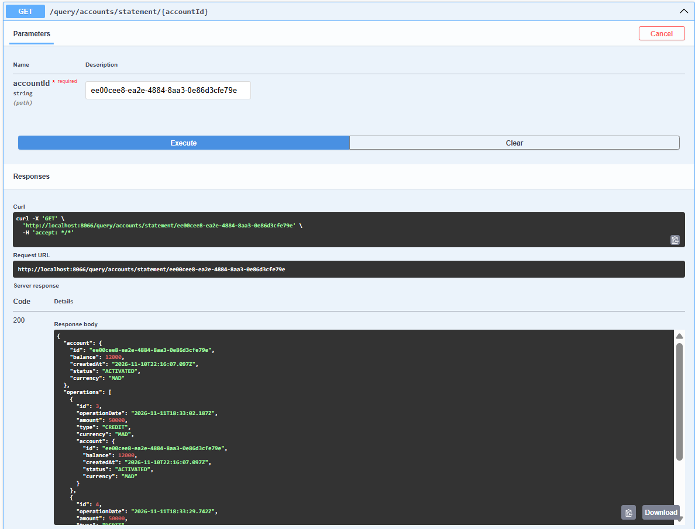
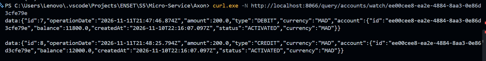
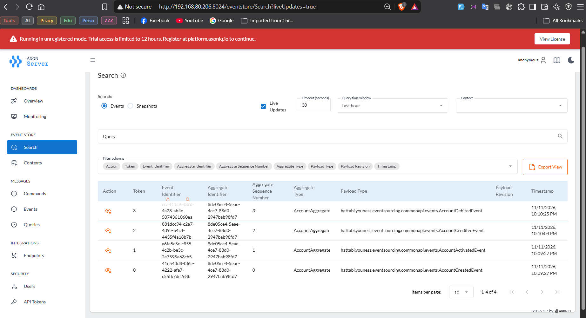

# Rapport de Travaux Pratiques : Event Sourcing et CQRS avec Spring Boot, Axon Framework et Axon Server

**Filière :** GLSID — Génie du Logiciel et des Systèmes Informatiques Distribués  
**Étudiant :** Youness HATTABI

---

## Table des matières

1. [Introduction](#1-introduction)
2. [Architecture générale](#2-architecture-générale)
3. [Infrastructure avec Docker Compose](#3-infrastructure-avec-docker-compose)
4. [Création du projet Spring Boot](#4-création-du-projet-spring-boot)
5. [Côté commande (Command Side)](#5-côté-commande-command-side)
6. [Côté lecture (Query Side)](#6-côté-lecture-query-side)
7. [Suivi temps réel avec SSE](#7-suivi-temps-réel-avec-sse)
8. [Intégration d'Axon Server](#8-intégration-daxon-server)
9. [Tests et résultats](#9-tests-et-résultats)
10. [Conclusion](#10-conclusion)

---

## 1. Introduction

Dans une architecture classique, l'état d'une application est stocké sous sa forme courante : chaque modification écrase la valeur précédente. Le pattern **Event Sourcing** adopte l'approche inverse : l'application enregistre la suite des **événements** qui ont modifié l'état, et l'état courant s'obtient en rejouant ces événements. Le pattern **CQRS** (_Command Query Responsibility Segregation_) sépare quant à lui les opérations d'écriture (commandes) des opérations de lecture (requêtes), qui peuvent alors utiliser des modèles et des bases de données différents.

L'objectif de ce travail pratique est d'implémenter ces deux patterns avec **Spring Boot**, **Axon Framework** et **Axon Server**, à travers une application de gestion de comptes bancaires. L'application permet de créer et d'activer un compte, de le créditer et de le débiter, de modifier son statut, de consulter la liste des comptes et le relevé d'un compte, et de suivre ses opérations en temps réel.

## 2. Architecture générale

L'application est un seul microservice découpé en deux parties.



**Côté commande.** Les requêtes REST sont transformées en commandes envoyées au bus de commandes par le `CommandGateway`. L'agrégat `AccountAggregate` applique la **fonction de décision** (vérification des règles métier) puis publie des événements. Ces événements sont stockés dans l'_Event Store_. L'état de l'agrégat est ensuite mis à jour par la **fonction d'évolution** (`@EventSourcingHandler`).

**Côté lecture.** Des _Event Handlers_ écoutent les événements de l'Event Store et les **projettent** dans une base relationnelle optimisée pour la consultation. Les requêtes passent par le `QueryGateway` et sont traitées par des _Query Handlers_.

**Conséquence.** Les deux modèles sont synchronisés de manière asynchrone : la lecture est **cohérente à terme** (_eventual consistency_).

## 3. Infrastructure avec Docker Compose

Trois conteneurs sont utilisés : PostgreSQL (base de lecture, et Event Store dans la première phase), pgAdmin pour l'administration, et Axon Server (utilisé dans la dernière phase).

```yaml
services:
  postgres:
    image: postgres:16
    container_name: es-postgres
    environment:
      POSTGRES_DB: account_db
      POSTGRES_USER: admin
      POSTGRES_PASSWORD: "1234"
    ports:
      - "5432:5432"
    volumes:
      - es-postgres-data:/var/lib/postgresql/data
    networks:
      - es-net

  pgadmin:
    image: dpage/pgadmin4
    container_name: es-pgadmin
    environment:
      PGADMIN_DEFAULT_EMAIL: admin@gmail.com
      PGADMIN_DEFAULT_PASSWORD: admin
    ports:
      - "8088:80"
    depends_on:
      - postgres
    networks:
      - es-net

  axonserver:
    image: docker.axoniq.io/axoniq/axonserver:latest
    container_name: es-axonserver
    environment:
      - AXONIQ_AXONSERVER_STANDALONE=true
    ports:
      - "8024:8024" # tableau de bord HTTP
      - "8124:8124" # gRPC
    volumes:
      - axon-data:/axonserver/data
      - axon-events:/axonserver/events
    networks:
      - es-net

volumes:
  es-postgres-data:
  axon-data:
  axon-events:

networks:
  es-net:
```

Dans la première phase, seuls PostgreSQL et pgAdmin sont démarrés :

```powershell
docker compose up -d postgres pgadmin
```

Docker s'exécute dans WSL et l'application Spring Boot directement sous Windows. Les ports publiés par Docker sont accessibles depuis Windows via `localhost`.

## 4. Création du projet Spring Boot

### 4.1. Choix des versions

| Composant      | Version                                     | Remarque                                                     |
| -------------- | ------------------------------------------- | ------------------------------------------------------------ |
| Java           | 21                                          |                                                              |
| Spring Boot    | 3.5.7                                       | Version la plus sûre avec Axon 4 et la sérialisation Jackson |
| Axon Framework | 4.13.1                                      | API `@Aggregate`, `@CommandHandler`, `@EventSourcingHandler` |
| springdoc      | `springdoc-openapi-starter-webmvc-ui` 2.8.9 | Documentation et tests via Swagger UI                        |
| Axon Server    | image Docker `latest`                       | Event Store et bus de messages                               |

Axon Framework 4.13 prend en charge Spring Boot 4, mais Spring Boot 4 utilise Jackson 3, dont le comportement avec le sérialiseur Axon 4 n'a pas été vérifié. Axon Framework 5 existe également, mais son API est différente de celle étudiée en cours. Le choix s'est donc porté sur Spring Boot 3.5.x avec Axon 4.13.x.

### 4.2. Dépendances principales

| Dépendance                  | Rôle                                                           |
| --------------------------- | -------------------------------------------------------------- |
| Spring Web                  | Endpoints REST et SSE.                                         |
| Spring Data JPA, PostgreSQL | Persistance de la base de lecture et token store d'Axon.       |
| Lombok                      | Réduction du code répétitif des entités.                       |
| `axon-spring-boot-starter`  | Configuration automatique d'Axon (bus, Event Store, agrégats). |
| Reactor Core                | Utilisation de `Flux` pour le flux SSE.                        |
| springdoc-openapi           | Interface Swagger UI.                                          |

### 4.3. Configuration (`application.properties`)

```properties
server.port=8066

spring.datasource.url=jdbc:postgresql://localhost:5432/account_db
spring.datasource.username=admin
spring.datasource.password=1234
spring.jpa.hibernate.ddl-auto=update

# Phase 1 : Event Store dans la base JPA. Supprimer cette ligne pour utiliser Axon Server (phase 2).
axon.axonserver.enabled=false

# Sérialisation JSON de tous les messages Axon
axon.serializer.general=jackson
axon.serializer.events=jackson
axon.serializer.messages=jackson

spring.jackson.serialization.fail-on-empty-beans=false
```

La propriété `axon.axonserver.enabled=false` désactive l'intégration d'Axon Server. Axon utilise alors un **Event Store JPA** : les événements sont enregistrés dans la table `domain_event_entry` de PostgreSQL. Le passage à Axon Server consiste uniquement à retirer cette ligne.

Les commandes, événements et requêtes sont implémentés sous forme de **records Java** (objets immuables). Ils sont sérialisés nativement par Jackson et évitent les problèmes de XStream avec Java 21.

### 4.4. Structure du projet

```text
docker-compose.yml
pom.xml
src/main/java/hattabi/youness/eventsourcing/
├── EventSourcingApplication.java
├── commonapi/
│   ├── enums/            AccountStatus, OperationType
│   └── events/           AccountCreatedEvent, AccountActivatedEvent,
│                         AccountCreditedEvent, AccountDebitedEvent,
│                         AccountStatusUpdatedEvent
├── command/
│   ├── aggregates/       AccountAggregate
│   ├── commands/         AddAccountCommand, CreditAccountCommand,
│   │                     DebitAccountCommand, UpdateAccountStatusCommand
│   ├── controllers/      AccountCommandController
│   └── dto/              *RequestDTO
└── query/
    ├── entities/         Account, AccountOperation
    ├── repositories/     AccountRepository, AccountOperationRepository
    ├── handlers/         AccountEventHandler, AccountQueryHandler
    ├── queries/          GetAllAccountsQuery, GetAccountStatementQuery, WatchEventQuery
    ├── dto/              AccountStatementResponseDTO
    └── controllers/      AccountQueryController
```

Le package `commonapi` contient les éléments partagés par les deux côtés : les événements et les énumérations.

## 5. Côté commande (Command Side)

### 5.1. Événements

Chaque événement est un fait immuable déjà survenu :

```java
public record AccountCreatedEvent(String accountId, double initialBalance,
                                  AccountStatus status, String currency) {}
public record AccountActivatedEvent(String accountId, AccountStatus status) {}
public record AccountCreditedEvent(String accountId, double amount, String currency) {}
public record AccountDebitedEvent(String accountId, double amount, String currency) {}
public record AccountStatusUpdatedEvent(String accountId, AccountStatus status) {}
```

### 5.2. Commandes

L'annotation `@TargetAggregateIdentifier` indique à Axon à quel agrégat la commande est destinée :

```java
public record AddAccountCommand(@TargetAggregateIdentifier String id,
                                double initialBalance, String currency) {}
public record CreditAccountCommand(@TargetAggregateIdentifier String id,
                                   double amount, String currency) {}
public record DebitAccountCommand(@TargetAggregateIdentifier String id,
                                  double amount, String currency) {}
public record UpdateAccountStatusCommand(@TargetAggregateIdentifier String id,
                                         AccountStatus status) {}
```

### 5.3. L'agrégat `AccountAggregate`

L'agrégat représente l'état courant d'un compte. Il comporte deux types de méthodes :

| Annotation              | Rôle                                                                                             |
| ----------------------- | ------------------------------------------------------------------------------------------------ |
| `@CommandHandler`       | **Fonction de décision** : vérifie les règles métier puis publie des événements avec `apply`.    |
| `@EventSourcingHandler` | **Fonction d'évolution** : met à jour l'état de l'agrégat. Aucune règle métier ni effet de bord. |

```java
@Aggregate
public class AccountAggregate {

    @AggregateIdentifier
    private String accountId;
    private double balance;
    private AccountStatus status;

    protected AccountAggregate() {}   // requis par Axon

    @CommandHandler
    public AccountAggregate(AddAccountCommand command) {
        if (command.initialBalance() <= 0)
            throw new IllegalArgumentException("The initial balance must be positive");
        AggregateLifecycle.apply(new AccountCreatedEvent(
                command.id(), command.initialBalance(), AccountStatus.CREATED, command.currency()));
        AggregateLifecycle.apply(new AccountActivatedEvent(command.id(), AccountStatus.ACTIVATED));
    }

    @EventSourcingHandler
    public void on(AccountCreatedEvent event) {
        this.accountId = event.accountId();
        this.balance = event.initialBalance();
        this.status = event.status();
    }

    @EventSourcingHandler
    public void on(AccountActivatedEvent event) {
        this.status = event.status();
    }

    @CommandHandler
    public void handle(DebitAccountCommand command) {
        if (status != AccountStatus.ACTIVATED)
            throw new RuntimeException("Account " + command.id() + " is not activated");
        if (command.amount() <= 0)
            throw new IllegalArgumentException("The amount must be positive");
        if (balance < command.amount())
            throw new RuntimeException("Insufficient balance: " + balance);
        AggregateLifecycle.apply(new AccountDebitedEvent(
                command.id(), command.amount(), command.currency()));
    }

    @EventSourcingHandler
    public void on(AccountDebitedEvent event) {
        this.balance -= event.amount();
    }

    // handle(CreditAccountCommand) et handle(UpdateAccountStatusCommand)
    // suivent le même schéma.
}
```

Une seule commande peut produire plusieurs événements : la création d'un compte publie `AccountCreatedEvent` puis `AccountActivatedEvent`. Les règles métier implémentées sont :

- un compte ne peut être créé qu'avec un solde initial positif ;
- les opérations de crédit et de débit exigent un compte au statut `ACTIVATED` et un montant positif ;
- un débit est refusé si le solde est insuffisant ;
- un changement de statut est refusé si le compte est déjà dans le statut demandé.

### 5.4. Contrôleur de commandes

```java
@RestController
@RequestMapping("/commands/accounts")
public class AccountCommandController {

    private final CommandGateway commandGateway;
    private final EventStore eventStore;

    // constructeur ...

    @PostMapping("/add")
    public CompletableFuture<String> addNewAccount(@RequestBody AddAccountRequestDTO request) {
        return commandGateway.send(new AddAccountCommand(
                UUID.randomUUID().toString(), request.initialBalance(), request.currency()));
    }

    @PutMapping("/credit")
    public CompletableFuture<String> creditAccount(@RequestBody CreditAccountRequestDTO request) {
        return commandGateway.send(new CreditAccountCommand(
                request.accountId(), request.amount(), request.currency()));
    }

    // debit et updateStatus : même principe

    @GetMapping("/events/{accountId}")
    public Stream<?> eventsByAccount(@PathVariable String accountId) {
        return eventStore.readEvents(accountId).asStream();
    }

    @ExceptionHandler(Exception.class)
    public ResponseEntity<String> handleException(Exception e) {
        return new ResponseEntity<>(e.getMessage(), HttpStatus.INTERNAL_SERVER_ERROR);
    }
}
```

Le `CommandGateway` envoie la commande de manière asynchrone, d'où le type de retour `CompletableFuture`. Pour une création, le résultat est l'identifiant de l'agrégat. L'endpoint `/events/{accountId}` est un outil de débogage qui relit directement les événements de l'Event Store ; le `@ExceptionHandler` renvoie le message d'erreur des règles métier au client.

## 6. Côté lecture (Query Side)

### 6.1. Modèle de lecture

Le modèle de lecture est composé de deux entités JPA :

| Entité             | Champs principaux                                                                 |
| ------------------ | --------------------------------------------------------------------------------- |
| `Account`          | `id`, `balance`, `createdAt`, `status`, `currency`                                |
| `AccountOperation` | `id`, `operationDate`, `amount`, `type` (`CREDIT`/`DEBIT`), `currency`, `account` |

Les interfaces `AccountRepository` et `AccountOperationRepository` (avec la méthode `findByAccountId`) fournissent l'accès aux données.

### 6.2. Projection des événements

Le `AccountEventHandler` s'abonne aux événements de l'Event Store avec `@EventHandler` et les projette dans la base de lecture :

```java
@EventHandler
public void on(AccountCreatedEvent event, @Timestamp Instant instant) {
    accountRepository.save(Account.builder()
            .id(event.accountId())
            .balance(event.initialBalance())
            .status(event.status())
            .currency(event.currency())
            .createdAt(instant)
            .build());
}

@EventHandler
public void on(AccountDebitedEvent event, @Timestamp Instant instant) {
    Account account = accountRepository.findById(event.accountId()).orElseThrow();
    AccountOperation operation = operationRepository.save(AccountOperation.builder()
            .amount(event.amount())
            .operationDate(instant)
            .type(OperationType.DEBIT)
            .currency(event.currency())
            .account(account)
            .build());
    account.setBalance(account.getBalance() - operation.getAmount());
    accountRepository.save(account);
}
```

L'annotation `@Timestamp` fournit la date technique de l'événement, enregistrée par Axon, sans qu'il soit nécessaire de la stocker dans l'événement lui-même.

Axon exécute ces handlers dans un _tracking event processor_ et mémorise sa position dans la table `token_entry`. Au premier démarrage, le processeur **rejoue tous les événements passés** et reconstruit ainsi la base de lecture à partir de l'historique, ce qui illustre le principal intérêt de l'Event Sourcing.

### 6.3. Requêtes et handlers de requêtes

```java
public record GetAllAccountsQuery() {}
public record GetAccountStatementQuery(String accountId) {}
```

```java
@QueryHandler
public List<Account> on(GetAllAccountsQuery query) {
    return accountRepository.findAll();
}

@QueryHandler
public AccountStatementResponseDTO on(GetAccountStatementQuery query) {
    Account account = accountRepository.findById(query.accountId()).orElseThrow();
    List<AccountOperation> operations = operationRepository.findByAccountId(query.accountId());
    return new AccountStatementResponseDTO(account, operations);
}
```

Le contrôleur n'accède pas directement aux repositories : il envoie la requête au `QueryGateway`, qui la route vers le handler correspondant.

```java
@GetMapping("/all")
public CompletableFuture<List<Account>> getAllAccounts() {
    return queryGateway.query(new GetAllAccountsQuery(),
            ResponseTypes.multipleInstancesOf(Account.class));
}

@GetMapping("/statement/{accountId}")
public CompletableFuture<AccountStatementResponseDTO> getAccountStatement(@PathVariable String accountId) {
    return queryGateway.query(new GetAccountStatementQuery(accountId),
            ResponseTypes.instanceOf(AccountStatementResponseDTO.class));
}
```

## 7. Suivi temps réel avec SSE

Pour pousser les opérations vers le client dès qu'elles surviennent, l'application combine une **requête d'abonnement** (_subscription query_) d'Axon, le `QueryUpdateEmitter` et un flux **Server-Sent Events**.

**Endpoint `watch` :**

```java
@GetMapping(value = "/watch/{accountId}", produces = MediaType.TEXT_EVENT_STREAM_VALUE)
public Flux<AccountOperation> watch(@PathVariable String accountId) {
    SubscriptionQueryResult<AccountOperation, AccountOperation> result =
            queryGateway.subscriptionQuery(
                    new WatchEventQuery(accountId),
                    ResponseTypes.instanceOf(AccountOperation.class),
                    ResponseTypes.instanceOf(AccountOperation.class));
    return result.initialResult()
            .filter(op -> op.getId() != null)
            .concatWith(result.updates())
            .doFinally(signal -> result.close());
}
```

**Handler du résultat initial** (objet vide, seules les mises à jour importent) :

```java
@QueryHandler
public AccountOperation on(WatchEventQuery query) {
    return new AccountOperation();
}
```

**Émission des mises à jour**, à la fin des handlers de débit et de crédit :

```java
queryUpdateEmitter.emit(
        WatchEventQuery.class,
        query -> query.accountId().equals(event.accountId()),
        operation);
```

Le filtre garantit que chaque abonné ne reçoit que les opérations du compte qu'il surveille. Le flux est testé avec `curl.exe -N` (le `.exe` est nécessaire dans PowerShell, où `curl` est un alias de `Invoke-WebRequest`).

## 8. Intégration d'Axon Server

Jusqu'ici, les événements étaient stockés dans PostgreSQL. Cette solution convient à une application monolithique, mais pas à un système distribué en plusieurs microservices, où il faut un composant capable de distribuer les événements, les commandes et les requêtes entre les services.

**Axon Server** joue ce rôle. Il est démarré par Docker Compose :

```powershell
docker compose up -d axonserver
```

Il suffit ensuite de supprimer `axon.axonserver.enabled=false` du fichier `application.properties`. Le connecteur Axon Server est déjà présent dans les dépendances de `axon-spring-boot-starter` et se connecte automatiquement. Les échanges avec l'application se font en **gRPC** sur le port 8124 ; le tableau de bord est accessible sur le port 8024.

Après le basculement :

- les événements sont stockés dans Axon Server et la table `domain_event_entry` cesse d'être alimentée ;
- les anciens comptes n'existent plus du point de vue d'Axon (le store est vide), il faut en créer de nouveaux ;
- la base de lecture et le token store doivent être réinitialisés, car la position mémorisée dans `token_entry` se rapporte à l'ancien Event Store :

```sql
TRUNCATE account_operation, account CASCADE;
DELETE FROM token_entry;
```

L'édition d'Axon Server utilisée s'affiche en mode « non enregistré » avec un accès d'essai limité à 12 heures. Cela suffit pour ce TP, mais un usage prolongé nécessite un enregistrement sur la plateforme d'AxonIQ.

## 9. Tests et résultats

### 9.1. Procédure de lancement

```powershell
# Infrastructure
docker compose up -d postgres pgadmin

# Application
.\mvnw.cmd spring-boot:run
```

Interface de test : `http://localhost:8066/swagger-ui.html`.



### 9.2. Vérification des fonctionnalités

| Test                   | Action                                       | Résultat obtenu                                                               |
| ---------------------- | -------------------------------------------- | ----------------------------------------------------------------------------- |
| Création de compte     | `POST /commands/accounts/add` (12000 MAD)    | Code 200, identifiant du compte renvoyé.                                      |
| Événements de création | `GET /commands/accounts/events/{id}`         | `AccountCreatedEvent` (séquence 0) puis `AccountActivatedEvent` (séquence 1). |
| Crédit et débit        | `PUT /credit` et `PUT /debit`                | `AccountCreditedEvent` et `AccountDebitedEvent` ajoutés au flux de l'agrégat. |
| Projection             | `GET /query/accounts/all`                    | Compte au statut `ACTIVATED`, avec solde et devise.                           |
| Relevé de compte       | `GET /query/accounts/statement/{id}`         | Compte et liste des opérations de crédit et de débit.                         |
| Suivi temps réel       | `curl.exe -N .../watch/{id}` puis opérations | Une ligne `data:{...}` reçue par opération, avec le solde mis à jour.         |
| Axon Server            | Page _Search_ du tableau de bord             | Quatre événements visibles pour le nouvel agrégat.                            |

**Création d'un compte :**



**Événements du compte après sa création** : deux événements sont enregistrés, `AccountCreatedEvent` puis `AccountActivatedEvent`, avec le type d'agrégat, l'identifiant, le numéro de séquence, l'horodatage, le contenu (`payload`) et des métadonnées de traçage.



**Événements de crédit et de débit** :



**Modèle de lecture, liste des comptes :**



**Réinitialisation du modèle de lecture** avant le rejeu des événements :



**Relevé de compte :**



**Flux temps réel (SSE)** : après un débit de 200 MAD, le solde passe à 11800 ; après un crédit de 200 MAD, il revient à 12000.



**Événements stockés dans Axon Server** : le store contient les événements `AccountCreatedEvent`, `AccountActivatedEvent`, `AccountCreditedEvent` et `AccountDebitedEvent` de l'agrégat, numérotés de 0 à 3.



## 10. Conclusion

Ce travail pratique a permis de mettre en œuvre les patterns **Event Sourcing** et **CQRS** dans une application complète, de l'envoi d'une commande REST jusqu'à la consultation et au suivi en temps réel des données.

Côté commande, l'agrégat sépare clairement la décision (vérification des règles métier) de l'évolution (mise à jour de l'état à partir des événements). Côté lecture, la projection des événements vers une base relationnelle produit un modèle adapté à la consultation, qui peut être reconstruit à tout moment en rejouant l'historique. La principale contrepartie est la cohérence à terme entre l'écriture et la lecture, ainsi qu'une certaine duplication de code entre commandes, événements et handlers.

Le passage d'un Event Store JPA à **Axon Server** s'effectue sans modifier le code métier, par une simple modification de configuration, et prépare l'application à un découpage en microservices distribués communiquant par événements.

---
